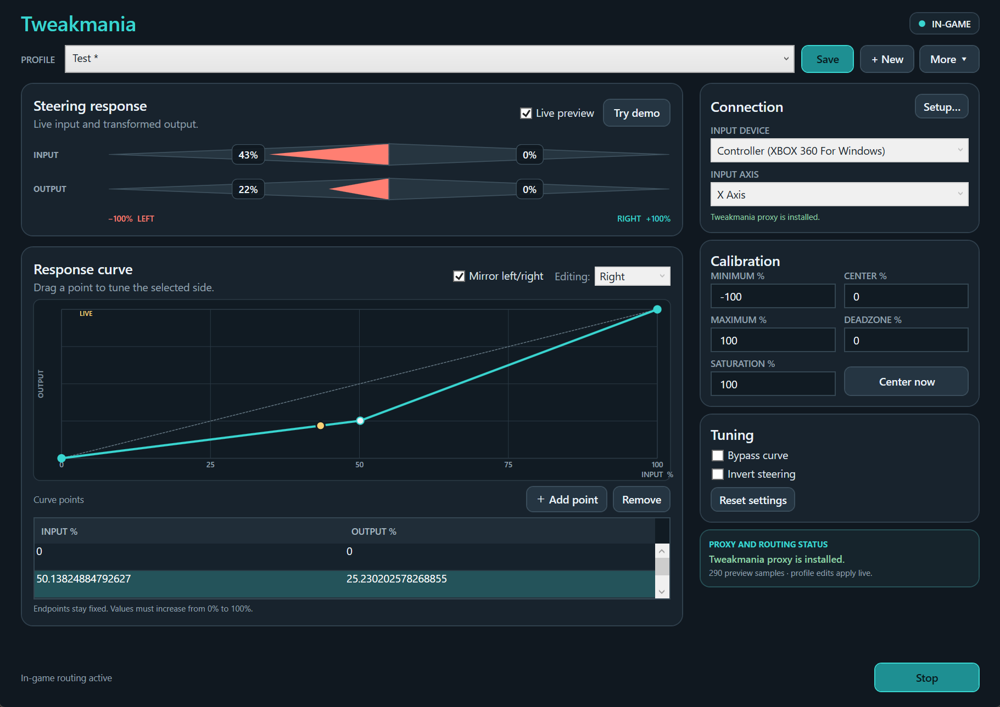

# Tweakmania



A Windows controller calibration and steering-curve editor for Trackmania United Forever (TMUF). Tweakmania uses a DirectInput 8 proxy to adjust one controller axis in game while preserving the original device identity and existing bindings.

## Why Tweakmania

Compared with the well-known DXTweak tool, once the proxy is loaded Tweakmania lets you change calibration without restarting the game or reconnecting the controller. Its response curves reshape steering without requiring you to restrict the controller's steering range.

The editor provides live calibration, independent left and right response curves, deadzone and saturation controls, bypass, and JSON profiles. Calibration endpoints can be set from -200% to +200%, while center remains within -100% to +100%. An endpoint above 100% extends the travel needed for full output: for example, a 125% positive maximum maps full physical travel to 80% output. Routing starts only when enabled. The x64 editor packages the x86 game proxy.

## User guide

See [INSTRUCTIONS.md](INSTRUCTIONS.md) for end-to-end setup, calibration tips, Windows Defender guidance, and update instructions. The portable release ships this user guide instead of this technical README.

This tool targets x86 DirectInput 8 games such as TMUF. It does not transform XInput calls or change controller behavior globally. The proxy changes only the selected absolute axis; other device inputs are forwarded.

## Build from source

Requirements: Windows x64, .NET 8 SDK, PowerShell 7, LLVM `clang-cl`/`lld-link`, and Visual Studio C++ build tools with the x86 Windows SDK.

```powershell
./Build.ps1
```

This creates a self-contained portable package in `dist/Tweakmania-<version>-portable` and a GitHub-ready `dist/Tweakmania-<version>-win-x64.zip`. Runtime and application DLLs are bundled into the compressed `Tweakmania.exe`, with English resources only and no debug symbols. The package also includes `INSTRUCTIONS.md`, the x86 proxy at `native/x86/dinput8.dll`, sample profiles, the license, and third-party notices (runtime notices are in `licenses`). WPF does not support trimming, so the portable package retains the desktop runtime. Native runtime libraries are extracted under `%TEMP%/.net` on first launch.

For a much smaller download, the framework-dependent option requires the x64 .NET 8 Desktop Runtime to be installed:

```powershell
./Build.ps1 -FrameworkDependent
```

This produces `dist/Tweakmania-<version>-framework-dependent` and `dist/Tweakmania-<version>-win-x64-framework-dependent.zip`, separately from the portable release. Both builds have a single executable at the package root. Extract into a fresh folder when upgrading from older packages with loose DLLs.

The package can be attached to a GitHub release as a zip. Do not publish the local `artifacts`, `dist`, `tests`, or `tools` folders; they contain generated output and development-only material.

See [THIRD-PARTY-NOTICES.md](THIRD-PARTY-NOTICES.md) for dependency notices. Tweakmania is an independent community tool and is not affiliated with or endorsed by Nadeo or Ubisoft.
